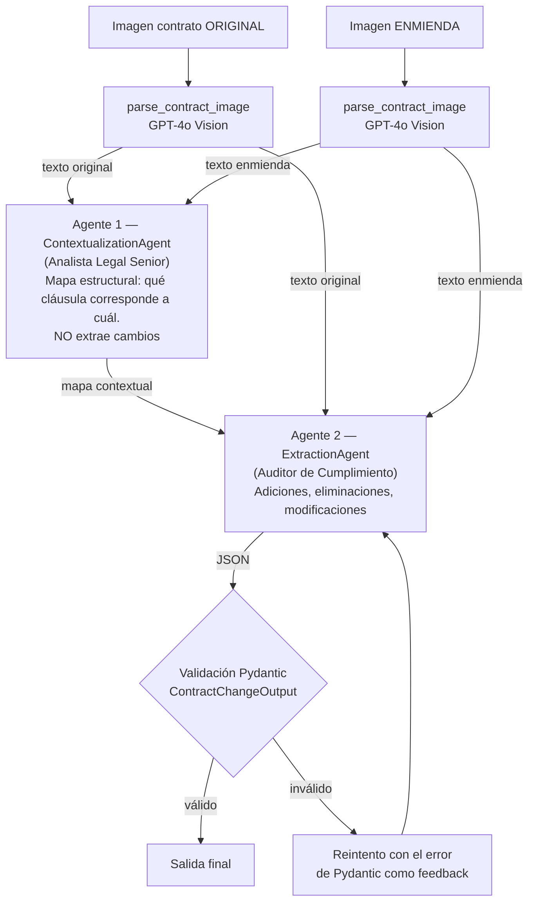

# Contract Comparison Agents — LegalMove

Sistema multi-agente que recibe **dos imágenes escaneadas** (un contrato original y su enmienda), lee
el texto con **GPT-4o Vision**, usa **dos agentes especializados** para entender la estructura y
detectar los cambios, y devuelve un **JSON validado con Pydantic**. Cada ejecución queda
completamente trazada en **Langfuse**.

> **Problema de negocio.** LegalMove procesa miles de enmiendas por mes y su equipo de Compliance
> dedica +40 horas semanales a comparar a mano cada contrato contra su adenda. Este sistema
> automatiza esa comparación: en ~10-20 segundos por par de documentos.

---

## 1. Arquitectura



**Flujo en una frase:** *imagen → texto (visión) → mapa estructural (Agente 1) → cambios (Agente 2) → JSON validado.*

### Trazabilidad en Langfuse (jerarquía de spans)

```
contract-analysis                      (traza raíz)
├── parse_original_contract            (generation: GPT-4o Vision, input/output, tokens, latencia)
├── parse_amendment_contract           (generation: GPT-4o Vision, input/output, tokens, latencia)
├── contextualization_agent            (agent)  └── ChatOpenAI (generation, tokens)
└── extraction_agent                   (agent)  └── ChatOpenAI (generation, tokens, validación)
```

Cada span guarda su **input**, **output**, **latencia** y **tokens**; el Agente 2 además registra cuántos
intentos de validación necesitó (`validation_attempts`). Si algo falla, el span queda marcado
como `ERROR` con el mensaje. Esta jerarquía fue verificada contra la API de Langfuse (ver sección 6).

## 2. Estructura del repositorio

```
contract-comparison-agents/
├── src/
│   ├── main.py                          # Script principal (recibe 2 paths de imágenes)
│   ├── image_parser.py                  # Validación, base64 y llamada multimodal a GPT-4o
│   ├── models.py                        # ContractChangeOutput (Pydantic)
│   ├── tracing.py                       # Integración con Langfuse (traza raíz + spans)
│   ├── config.py                        # Modelos, timeouts, reintentos, límites (desde .env)
│   └── agents/
│       ├── contextualization_agent.py   # Agente 1: Analista Legal Senior
│       └── extraction_agent.py          # Agente 2: Auditor de Cumplimiento
├── data/
│   ├── test_contracts/                  # 3 pares de imágenes (6 JPG) + README
│   └── golden_cases.json                # Cambios esperados de cada par
├── tests/test_models_and_images.py      # Tests sin API (Pydantic + validación de imágenes)
├── run_golden.py                        # Evaluación contra los golden cases
├── outputs/golden_results.json          # Resultado real de la última evaluación
├── requirements.txt                     # Dependencias con versiones fijadas
└── .env.example                         # Plantilla de variables de entorno
```

## 3. Instalación

Requisitos: Python 3.10+ (probado con 3.12), una API key de OpenAI con acceso a `gpt-4o`, y
(opcional pero recomendado) una cuenta gratuita de [Langfuse Cloud](https://cloud.langfuse.com).

```bash
git clone https://github.com/maciahnos/contract-comparison-agents.git
cd contract-comparison-agents

python -m venv .venv
# Windows (PowerShell):   .\.venv\Scripts\Activate.ps1
# macOS / Linux:          source .venv/bin/activate

pip install -r requirements.txt

cp .env.example .env        # Windows: copy .env.example .env
# Editá .env y completá OPENAI_API_KEY, LANGFUSE_PUBLIC_KEY y LANGFUSE_SECRET_KEY
```

Si no se configuran las claves de Langfuse, el sistema funciona igual pero **sin trazas** (avisa por consola).

## 4. Uso

```bash
# Comparar un par de documentos (los paths son argumentos)
python src/main.py data/test_contracts/documento_3__original.jpg data/test_contracts/documento_3__enmienda.jpg

# Guardar el JSON y ver también los textos leídos y el mapa del Agente 1
python src/main.py data/test_contracts/documento_1__original.jpg data/test_contracts/documento_1__enmienda.jpg --out outputs/caso1.json --verbose

# Evaluar los 3 pares contra los cambios esperados (golden cases)
python run_golden.py

# Tests que no usan la API
python -m pytest -q
```

Salida de ejemplo (par 3, contrato SaaS):

```json
{
  "sections_changed": ["Cláusula 3 - Precio", "Cláusula 4 - Disponibilidad del Servicio", "Cláusula 5 - Soporte"],
  "topics_touched": ["precio", "disponibilidad del servicio", "soporte técnico"],
  "summary_of_the_change": "El precio mensual pasa de USD 1.200 a USD 1.250. La disponibilidad del servicio garantizada aumenta del 99,5% al 99,9%. Se añade un sistema de tickets en línea como nuevo medio de soporte, además del correo electrónico."
}
```

Códigos de salida: `0` éxito · `1` error de configuración (p. ej. falta la API key) · `2` imagen de entrada inválida · `3` fallo del análisis (API o validación).

## 5. Decisiones técnicas

**¿Por qué dos agentes y no uno?** Comparar dos documentos largos "de una sola vez" mezcla dos tareas
distintas: *entender cómo está organizado cada documento* y *auditar las diferencias*. Separarlas
da (a) prompts cortos y enfocados, cada uno con un rol propio (Analista vs. Auditor); (b) un
**mapa contextual** que obliga al Auditor a recorrer cláusula por cláusula en vez de depender de
su memoria global (así detecta cambios sutiles, como la eliminación de la palabra "intransferible" en la
cláusula 1 del caso 1); y (c) trazas más claras: si algo sale mal, se ve en cuál de los dos pasos.

**¿Por qué GPT-4o para el parsing?** Los contratos escaneados mezclan títulos, cláusulas numeradas
y cifras. Un modelo multimodal hace OCR y entiende el layout en un solo paso (no se acumulan
errores de un pipeline OCR → texto → LLM) y conserva la jerarquía de cláusulas. Se usa `detail="high"`
para leer cifras con precisión (una coma mal leída cambia un monto) y `temperature=0`
para resultados reproducibles. Los agentes también usan GPT-4o: en un caso legal es preferible
priorizar precisión sobre costo.

**Diseño de los prompts.** Cada system prompt define un *rol*, un *método* y *reglas negativas*:
- *Transcriptor OCR jurídico*: transcribe literal, sin resumir ni corregir; marca `[ilegible]` en vez de inventar.
- *Analista Legal Senior*: devuelve un informe con formato fijo (identificación, tabla de correspondencia, observaciones) y tiene prohibido describir cambios.
- *Auditor de Cumplimiento*: recorre el mapa fila por fila, ignora diferencias de formato, **no inventa** cambios y describe cada uno con valor anterior y nuevo.

**Validación de la salida (Pydantic).** `ContractChangeOutput` tiene exactamente tres campos y
`extra="forbid"` (si el modelo agrega un campo, se rechaza). La validación es en dos capas:
Structured Outputs de OpenAI (`json_schema`) obliga al modelo a respetar el esquema, y
además se vuelve a validar con `model_validate()` (reglas propias: textos no vacíos, resumen con contenido).
Si falla, se le devuelve **el error de Pydantic al modelo** y se reintenta una vez; si vuelve a fallar se
lanza `ExtractionError` con un mensaje claro.

**Gestión de la API y de errores.**
- Archivos de entrada validados *antes* de gastar tokens: existencia, extensión (`jpg/jpeg/png`), tamaño (≤ 20 MB), firma real del archivo (que un `.jpg` sea realmente un JPEG) y que no esté **truncado** (un JPEG debe terminar en `FFD9`). Esto nació de un caso real: una imagen descargada a medias hacía que el sistema "no viera" la cláusula 7 de la enmienda del caso 2.
- Reintentos con espera exponencial (2 s, 4 s, 8 s) solo para errores transitorios (rate limit, timeout, caída de red, 5xx). Los errores permanentes (400, API key inválida) fallan de inmediato con un mensaje claro.
- Se detecta que la transcripción se cortó por límite de tokens (`finish_reason == "length"`), que el modelo se negó, o que no hay texto.
- Las claves viven en `.env` (nunca en el código ni en git); `.env.example` documenta cada variable.
- Si Langfuse no está configurado, el sistema no se rompe.

## 6. Resultados medidos

Ejecución real (`python run_golden.py`) sobre los 3 pares de ejemplo del curso, comparando contra los cambios esperados:

| Caso | Tipo | Cambios esperados detectados | Texto leído correctamente | Tiempo total |
|---|---|---|---|---|
| 1 — Licencia de software | Complejo (4 modificaciones + 1 cláusula nueva) | 5 / 5 (100 %) | Sí | ~18 s |
| 2 — Consultoría | Complejo (4 modificaciones + 1 cláusula nueva) | 5 / 5 (100 %) | Sí | ~10 s |
| 3 — SaaS | Simple (3 modificaciones) | 3 / 3 (100 %) | Sí | ~8 s |

Además, en el caso 1 el Agente 2 detectó un cambio sutil que **no figuraba** en los cambios esperados del curso: la licencia
dejó de ser "intransferible" y pasó de "fines internos de la empresa" a "operaciones internas de negocio".

Ejemplo de consumo (caso 1, medido en Langfuse): lectura del original ≈ 1.600 tokens, lectura de la enmienda ≈ 1.600,
Agente 1 ≈ 1.600, Agente 2 ≈ 2.100 → ~6.900 tokens por par.
La jerarquía de spans fue verificada contra la API pública de Langfuse (observaciones anidadas bajo `contract-analysis`).

**Limitaciones conocidas.** Evaluamos con escaneos nítidos de una página; con fotos borrosas, muy inclinadas o de varias
páginas habría que ampliar el parseo (p. ej. procesar página por página). La métrica de completitud usa palabras clave
sobre la salida, que es una aproximación razonable pero no un juicio semántico completo.
